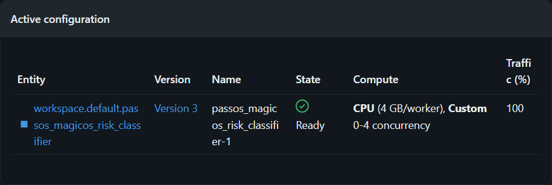
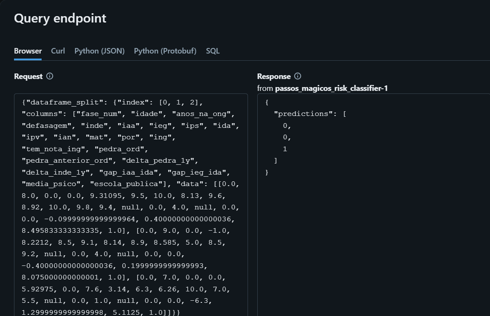
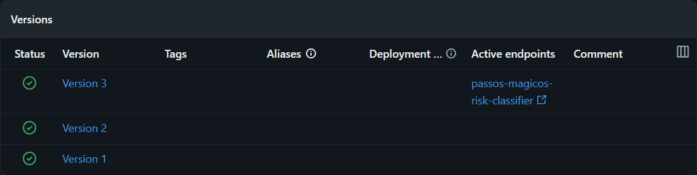
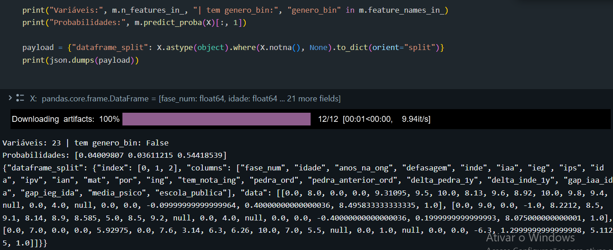

# Passos Mágicos — Pipeline MLOps Longitudinal (PEDE 2022–2025)

Pipeline de Machine Learning e engenharia MLOps aplicado aos dados longitudinais da **Associação Passos Mágicos (PEDE, 2022–2025)**, estruturado com **anti-leakage** estrito ($t \rightarrow t+1$), validação *out-of-time* (OOT), explicabilidade local (**SHAP**), diagnóstico de **calibração probabilística** (*Brier Score*, *Isotonic* & *Platt Scaling*), teste estatístico não paramétrico **KS**, **MLflow Registry**, **Quality Gate**, **FastAPI**, **Streamlit** (4 abas) e monitoramento de **drift** via **PSI**.

## A História por Trás do Pipeline

Na Associação Passos Mágicos, agir cedo faz toda a diferença na trajetória de crianças e jovens em situação de vulnerabilidade. Quando um estudante começa a perder tração no ciclo $t$, esperar o problema se consolidar no ciclo seguinte ($t+1$) torna o acompanhamento mais difícil — mas sair apontando "rótulos" automáticos sem contexto seria pedagógica e eticamente inadequado.

Por isso, este projeto foi desenhado como um **radar preventivo com apoio *Human-in-the-Loop***: o modelo estima sinais prospectivos ($t \rightarrow t+1$) para ajudar a equipe multidisciplinar a priorizar quem pode precisar de atenção adicional, mantendo sempre a decisão final com quem acompanha o estudante de perto.

Ao longo da construção, cada camada técnica respondeu a um desafio concreto dos dados longitudinais:

1. **Respeitar o tempo sem vazar o futuro:** os splits cronológicos (`2022→2023`, `2023→2024` e teste OOT `2024→2025`) e as 23 features garantem que o treino não "espie" o futuro nem estatísticas globais.
2. **Priorizar quem não pode ficar para trás:** como deixar de apoiar um estudante em risco tem custo assimétrico, o *Quality Gate* avalia *PR-AUC*, *ROC-AUC* e *Recall* com limiar calibrado via *F2-Score* (`0.38`) frente ao *baseline* heurístico.
3. **Explicar cada caso e auditar a confiança das probabilidades:** o módulo SHAP local (`xai_local.py`) mostra o que puxa o risco para cima ou para baixo em uma simulação específica, enquanto `calibration_diag.py` compara probabilidade bruta, *Isotonic* e *Platt scaling* (*Brier Score* e *Reliability Diagram*) fora da amostra.
4. **Enxergar quando o mundo muda:** quando a reestruturação metodológica de 2025 altera a distribuição das variáveis (*domain shift*), o monitoramento de *drift* (**PSI** e **KS**) sinaliza a mudança, sob demanda, para que a equipe decida sobre o retreinamento em vez de deixar o modelo operar "no escuro".

---

## 1. Hipótese Científica e Desenho Anti-Leakage

- **Objetivo:** Estimar no ciclo $t$ a necessidade de acompanhamento educacional/psicopedagógico no ciclo subsequente ($t+1$), apoiando a atuação preventiva da equipe multidisciplinar com abordagem *Human-in-the-Loop*.
- **Prevenção de Data Leakage ($t \rightarrow t+1$):** Divisão cronológica estrita (*out-of-time*: treino `2022→2023`, validação `2023→2024`, teste OOT `2024→2025`), impedindo que informações futuras ou transformações ajustadas em toda a série temporal contaminem treino ou avaliação.
- **Reestruturação PEDE 2025 e Inferência Estatística:** Mudanças metodológicas entre ciclos geram *domain shift* e ausência não aleatória (*MAR/MNAR*). O pipeline audita mudanças usando estatística descritiva, teste de Kolmogorov-Smirnov (`ks_2samp`) e *Population Stability Index* (**PSI**).

---

## Trajetória Analítica até a Fase 5

A construção desta solução apoia-se na evolução progressiva ao longo das fases do programa, unindo rigor analítico, modelagem, aprendizagem profunda/NLP e engenharia de MLOps:

- **Fase 1 — Estruturação analítica e risco com CRISP-DM:** base metodológica de entendimento do problema, preparação de dados e modelagem de risco (`payflow-risk-model-crispdm`) com foco em validação e disciplina analítica.
- **Fase 2 — Pipelines e dados educacionais:** amadurecimento de fluxos de processamento e avaliação em contexto educacional (`pipeline-hibrido-alfabetizacao-brasil`).
- **Fase 3 — Machine Learning e MLOps:** consolidação de práticas de treino, avaliação, registo e operacionalização de modelos.
- **Fase 4 — Deep Learning and NLP:** aprofundamento em arquiteturas neurais e processamento de linguagem natural, ampliando a leitura de sinais complexos e não lineares.
- **Fase 5 — MLOps Longitudinal na Passos Mágicos (PEDE 2022–2025):** aplicação de desenho *anti-leakage* ($t \rightarrow t+1$), validação *out-of-time*, explicabilidade local por estudante (**SHAP**), calibração probabilística (*Isotonic Regression* e *Platt Scaling* com *Reliability Diagram*), análise de *drift* (KS e PSI), governação com *MLflow Registry* e *Quality Gate*, serviço em *FastAPI*, visualização interativa de 4 abas em *Streamlit* (*Human-in-the-Loop*) e automação de qualidade (**12 testes automatizados**).

---

## 2. Estrutura do Repositório

- `.github/workflows/`: integração contínua (`flake8` lint e suíte de testes automatizados).
- `artifacts/`: modelo campeão (`champion_model.joblib` — `candidate_random_forest` v1.0.0, limiar F2 `0.38`), relatórios de *quality gate* e *drift*, e trilha de auditoria JSONL.
- `data/raw/`, `data/processed/`, `data/reference/`: base bruta, splits temporais em Parquet (`train_2022_2023`, `val_2023_2024`, `test_2024_2025`) e base de referência para *drift*.
- `docs/`: *Architecture*, *Data Card*, *Model Card* e *Monitoring Plan*.
- `notebooks/`: cadernos `01`, `02` e `03` (EDA/qualidade, features/experimentos e registry/quality gate/serving).
- `src/api/`: API REST tipada em FastAPI (`/health`, `/predict`) com contratos Pydantic e auditoria de inferências.
- `src/app/`: interface interativa em Streamlit (`streamlit_app.py`), módulo de explicabilidade local (`xai_local.py`) e diagnóstico de calibração (`calibration_diag.py`).
- `src/monitoring/` & `src/pipeline/`: detector de *drift* (`drift_detector.py`) e pipeline ML (`data_validation.py`, `features.py`, `train.py`, `evaluate.py`, `register.py`).
- `tests/`: suíte de **12 testes automatizados** com `Pytest` (`test_features.py`, `test_input_validation.py`, `test_model_quality_gate.py`, `test_xai_and_calibration.py`).

---

## Arquitetura da Solução

O pipeline vai do dado bruto até a decisão humana, passando por um Quality Gate antes do registro do modelo:

```
        [ Base PEDE (Excel, ciclos 2022-2025) ]
                         |
                         v
        [ Validação de Entrada: data_validation.py ]
                         |
                         v
   [ Features Longitudinais: ciclo t -> risco em t+1 ]
      23 variáveis (sem genero_bin) | Split temporal
                         |
                         v
   [ Treino e Seleção do Campeão: Random Forest ]
            Rastreamento no MLflow
                         |
                         v
   [ Quality Gate: métricas, calibração e XAI ]
                         |
            reprovado    |    aprovado
         (não registra)  v
   [ Registro: Unity Catalog (Databricks), versão 3 ]
                         |
         +---------------+----------------+
         v                                v
 [ Model Serving: Databricks ]    [ API FastAPI (Docker) ]
                                           |
                    +----------------------+----------------+
                    v                                       v
     [ Dashboard Streamlit + XAI local ]     [ Log de Auditoria (JSONL) ]
                    |                                       |
                    |                                       v
                    |                   [ Auditoria de Drift: PSI + KS ]
                    |                       (sob demanda, vs. base de referência)
                    |                                       |
                    +-------------------+-------------------+
                                        v
               [ Revisão Humana: Equipe Pedagógica decide ]
```

---

## 3. Como Executar Localmente

### Ambiente, Lint e Suíte de 12 Testes

```bash
python -m venv .venv
source .venv/Scripts/activate
pip install -r requirements.txt
flake8 src tests --max-line-length=120 --ignore=E501,W503,E402
PYTHONPATH=. pytest -v tests/
```

## Deploy na Databricks

O modelo foi treinado, registrado e publicado na Databricks Free Edition:

- **Treino:** pipeline do projeto executado em notebook, com rastreamento no MLflow.
- **Registro:** Unity Catalog, `workspace.default.passos_magicos_risk_classifier`, versão 3.
- **Modelo:** Random Forest com 23 variáveis, sem `genero_bin`, aprovado no Quality Gate.
- **Serving:** endpoint `passos-magicos-risk-classifier` (CPU 4 GB, scale to zero).
- **URL:** https://dbc-6beb4054-21cf.cloud.databricks.com/serving-endpoints/passos-magicos-risk-classifier/invocations
- **Teste:** 3 registros de validação, resposta `[0, 0, 1]`.

O endpoint exige autenticação e retorna a classe com o corte padrão de 0,5, e não o limiar de 0,38 definido no projeto.


### Evidências





